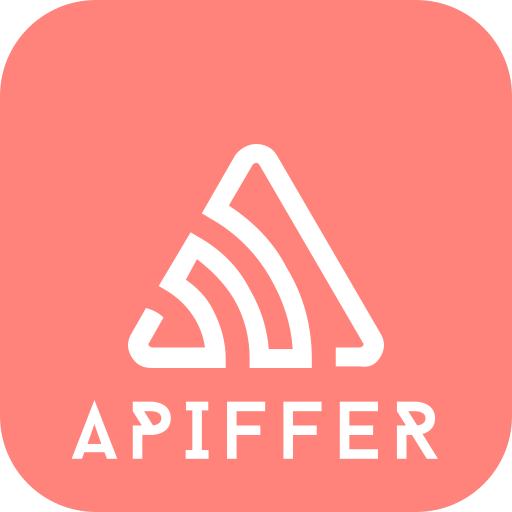

# Apiffer 

This is the README for  "Apiffer". All the details are mentioned here.





## 🚀 About Apiffer

Apiffer is an platform which we have created where someone who has little or no knowledge about Backend can easily and quickly create APIs hassle free
## Features

- Create fast GET APIs 
- No backend knowledge required
- Host into our server for free 
- User api endpoints in your personal project


## Support

For support, email at sm896774231@gmail.com 


## Tech Stack

**Client:** React, Redux, TailwindCSS

**Server:** Node js, Express js, Pm2, docker, docker-compose


## Color Reference

| Color             | Hex                                                                |
| ----------------- | ------------------------------------------------------------------ |
| Light Orange|  #ff837b |
| Grey |  #808080 |


## License


[](https://opensource.org/licenses/)

## Run Locally

Clone the project

```bash
  git clone https://github.com/apiffer-apis/apiffer.git
```

Go to the project directory

```bash
  cd apiffer
```

Install dependencies

```bash
  npm install
```

Start the server

```bash
  npm run start
```


## API Reference


| Parameter | Type     |               
| :-------- | :------- |
| `path` | `string` |
|`method`| `string`|
|`body`| `string`|

## Inspiration

I've seen many of my frontend friends try to make dynamic web apps without knowing any backend or API knowledge. What they do is they try to use the APIs mentioned in the tutorial they're following but most of them don't work or have rate limitations. So we tried to create a platform where you can quickly create APIs without any backend knowledge.


## Challenges we ran into

Time Constraint: Time was a very big factor to build our prototype since it is a very big project and to complete it within a limited time frame was a very big factor

Our app Performs better on local network. For production purpose we have to open multiple ports or create a lot of reverse proxy configs. Instead of a web app, we could have made a vs code extension but due to limited time and knowledge of making an extension, we could not complete it but we hope to make it in the near future

Authentication & Authorisation: we haven't added the authentication and authorization. If we want to allow multiple users then for each user we have to create a new reverse proxy but that's not a good solution. We think the optimised solution will be like if we create a new server which will hold all new proxies and we'll create pm2 nodes for each proxy but that would require a lot of experiments. We can rather make this a local area-based application like we mentioned in the vs code extension or windows application


    